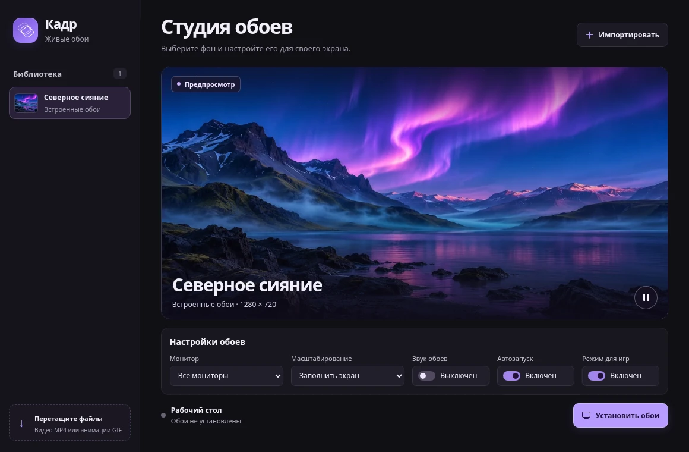

# Кадр

Кадр устанавливает локальные MP4 и GIF как живые обои в Windows 10 и 11. Интерфейс на русском, с библиотекой файлов и предпросмотром. Встроенные обои «Северное сияние» можно попробовать сразу.



## Запуск

1. Скачайте ZIP для Windows x64 в разделе [Releases](../../releases) и распакуйте его.
2. Запустите `kadr-wallpaper.exe`. Приложению нужен [Microsoft Edge WebView2 Runtime](https://developer.microsoft.com/microsoft-edge/webview2/).
3. Перетащите MP4 или GIF в окно либо нажмите **Импортировать**. Выберите монитор, способ масштабирования и звук, затем нажмите **Установить обои**.

Кнопка закрытия убирает окно в область уведомлений Windows. Через значок Кадра можно открыть окно, поставить обои на паузу, снять их или выйти из приложения. На паузе видны штатные обои Windows. При следующем запуске Кадр восстановит последнюю установку.

Библиотека хранит ссылки на исходные файлы. Если переместили файл, удалите старую запись и импортируйте его заново. Для MP4 рекомендуется видео H.264, а для звука — AAC. При установке на несколько мониторов звук воспроизводится только на одном из них.

## Сборка на Windows

Установите Rust 1.88 или новее и MSVC Build Tools с Windows SDK. Соберите и запустите Кадр в PowerShell.

```powershell
cargo build --release --locked
.\target\release\kadr-wallpaper.exe
```

Проверки запускаются через Cargo.

```powershell
cargo fmt --all -- --check
cargo clippy --locked --all-targets -- -D warnings
cargo test --locked
```

GitHub Actions собирает ZIP после успешных проверок. Теги вида `v0.1.0` публикуют ZIP в Releases.

## Как устроено

Rust управляет библиотекой, настройками, мониторами, окнами Explorer и областью уведомлений. WebView2 декодирует MP4 и отображает кадры GIF. Приложение отдаёт медиа своему проигрывателю через локальный адрес `127.0.0.1`. MP4 читается с диска по диапазонам байтов. Настройки лежат в `%LOCALAPPDATA%\KadrWallpaper\settings.json`.

Кадр использует слои окна Explorer за значками рабочего стола. Microsoft не предоставляет публичный API для этого режима, поэтому изменения Explorer в новых сборках Windows могут влиять на совместимость.
